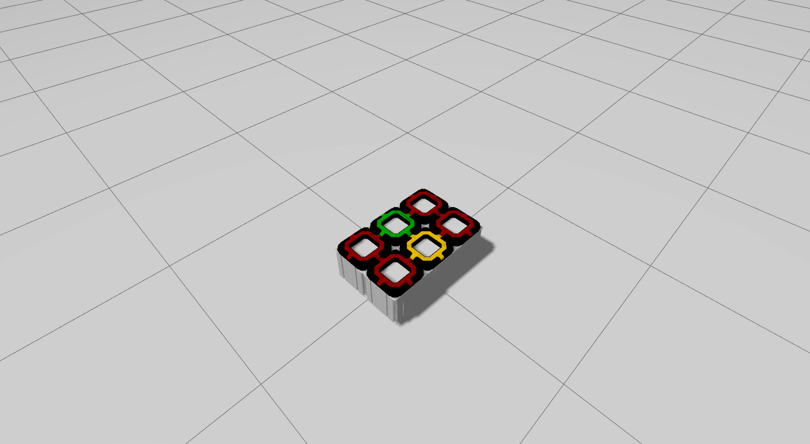

# robile_gazebo

Gazebo simulations for KELO ROBILE robots

## Installation
In addition to a few ROS dependencies, this package also depends on the following packages provided by KELO-robotics:
1. [kelo_tulip](https://github.com/kelo-robotics/kelo_tulip)
2. [robile_description](https://github.com/kelo-robotics/robile_description)

Assuming you have a ROS 2 workspace at `~/ros2_ws`, execute the following commands to build the simulator and install its dependencies:

~~~ sh
sudo apt install ros-$ROS_DISTRO-controller-manager ros-$ROS_DISTRO-effort-controllers ros-$ROS_DISTRO-velocity-controllers ros-$ROS_DISTRO-joint-state-controller ros-$ROS_DISTRO-ros-gz-sim ros-$ROS_DISTRO-gz-ros2-control ros-$ROS_DISTRO-ros-gz-bridge

cd ~/ros2_ws/src
git clone https://github.com/kelo-robotics/kelo_tulip.git
git clone https://github.com/kelo-robotics/robile_description.git
git clone https://github.com/kelo-robotics/robile_gazebo.git

colcon build kelo_tulip # you will need to enter your password for the kelo_tulip build to complete

colcon build robile_description robile_gazebo
source ~/ros2_ws/source/setup.bash
~~~

## Usage

To start the gazebo simulator, use one of the launch files defined in the [launch/](launch/) directory as follows:

~~~ sh
ros2 launch robile_gazebo simulation.launch.py
~~~

You can then publish command velocities on the ros topic `/cmd_vel` to move the robot around. For example, to move the robot forward with 0.5 m/s velocity, execute the below command in a new terminal:

~~~ sh
ros2 topic pub /cmd_vel geometry_msgs/msg/Twist "{linear: {x: 0.5, y: 0.0, z: 0.0}, angular: {x: 0.0, y: 0.0, z: 0.0}}" -r 10
~~~

### Moving the robot using a keyboard

The [teleop_twist_keyboard](https://index.ros.org/r/teleop_twist_keyboard/) ROS package can be used to simplify controlling the motion of the robot. This requires a one time installation of the `teleop_twist_keyboard` package using the below command:

~~~ sh
sudo apt install ros-$ROS_DISTRO-teleop-twist-keyboard
source /opt/ros/$ROS_DISTRO/setup.bash
~~~

Then start the `teleop_twist_keyboard` node using the command `ros2 run teleop_twist_keyboard teleop_twist_keyboard` and move the robot as per the instructions displayed on the terminal. Below is an example of the output after running the node:

~~~
ros2 run teleop_twist_keyboard teleop_twist_keyboard
This node takes keypresses from the keyboard and publishes them
as Twist/TwistStamped messages. It works best with a US keyboard layout.
---------------------------
Moving around:
   u    i    o
   j    k    l
   m    ,    .

For Holonomic mode (strafing), hold down the shift key:
---------------------------
   U    I    O
   J    K    L
   M    <    >

t : up (+z)
b : down (-z)

anything else : stop

q/z : increase/decrease max speeds by 10%
w/x : increase/decrease only linear speed by 10%
e/c : increase/decrease only angular speed by 10%

CTRL-C to quit

currently:	speed 0.50	turn 1.00 
~~~

### Additional launch file arguments
Several arguments can be passed when launching the simulator. A complete list of supported ros2 launch arguments can be found in the [launch/simulation.launch.py](launch/simulation.launch.py) file. We list a few most important ones here.
| Argument name        | Type    | Default | Description                                                                   |
|----------------------|---------|---------|-------------------------------------------------------------------------------|
| config | string | 4_wheel_config | name of the robot URDF xacro file | 
| platform_max_lin_vel | float   | 1.0     | Maximum linear velocity the platform can achieve in the XY plane (in m/s)     |
| platform_max_ang_vel | float   | 1.0     | Maximum angular velocity the platform can achieve along the Z axis (in rad/s) |
| init_pos_x           | float   | 0.0     | Spawn position of robot along the world X-axis                                |
| init_pos_y           | float   | 0.0     | Spawn position of robot along the world Y-axis                                |
| init_yaw             | float   | 0.0     | Spawn orientation of robot along the world Z-axis                             |
| start_rviz           | boolean | true    | Start RViz with a predefined RViz configuration file                          |

For example to change the spawn position of the robot to `(2.0, 3.0)`, use the below command:

~~~ sh
ros2 launch robile_gazebo simulation.launch.py init_pos_x:=2.0 init_pos_y:=3.0
~~~

## TUTORIAL: Adding a custom ROBILE platform
Simulating a custom platform, requires defining the robot configuration in a URDF file. This must be done in the [robile_description](TODO:add_link) package and detailed instructions for the same are available [here](TODO:add_link)
### Step-2: Define ros-control configuration file for the custom platform
Lets assume our custom platform config is called `simple_config` (continuing from the [robile_description tutorial](TODO:add_link)). Follow the below steps to add ros-controllers for the custom platform.
1. Add a new file called `simple_config.yaml` in the directory [config/ros_controller/](config/ros_controller/). **This file name must match the name of the platform defined in the robile_description package.**

2. Add the following block of code to the file to create a [joint_state_controller](https://index.ros.org/r/gz_ros2_control/#humble).

~~~ yaml
controller_manager:
  ros__parameters:
    use_sim_time: true
    update_rate: 100

    joint_state_broadcaster:
      type: joint_state_broadcaster/JointStateBroadcaster
~~~
3. Now add joints in the file defined in the platform configuration file 'robile_description/urdf/simple_config.urdf.xacro', include the below block of the code in the YAML file. Replace the `<ROBILE_MODULE_NAME>` with the actual name defined for the ROBILE module in the URDF file.
~~~ yaml
robile_hub_wheels_controller:
  ros__parameters:
    joints:
      - <ROBILE_MODULE_NAME>_drive_left_hub_wheel_joint
      - <ROBILE_MODULE_NAME>_drive_right_hub_wheel_joint
    command_interfaces:
      - velocity
    state_interfaces:
      - velocity
      - position
~~~
4. A complete `config/ros_controller/simple_config.yaml` should look something like the one shown below:
~~~ yaml
controller_manager:
  ros__parameters:
    use_sim_time: true
    update_rate: 100

    joint_state_broadcaster:
      type: joint_state_broadcaster/JointStateBroadcaster
    robile_hub_wheels_controller:
      type: velocity_controllers/JointGroupVelocityController

robile_hub_wheels_controller:
  ros__parameters:
    joints:
      - robile_3_drive_left_hub_wheel_joint
      - robile_3_drive_right_hub_wheel_joint
      - robile_4_drive_left_hub_wheel_joint
      - robile_4_drive_right_hub_wheel_joint
    command_interfaces:
      - velocity
    state_interfaces:
      - velocity
      - position
~~~
5. Then launch your robot with this command which will load the robot in the simulation
~~~ sh
ros2 launch robile_gazebo simulation.launch.py config:=simple_config
~~~